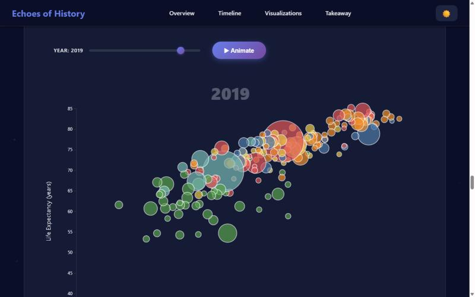

# Echoes of History: Did the World Grow More Equal in Health or in Wealth?

[](https://aryaharsh5559.github.io/global-development-data-story/)

**Live site:** [aryaharsh5559.github.io/global-development-data-story/](https://aryaharsh5559.github.io/global-development-data-story/)

An interactive, scroll-driven data story built on 60 years of World Bank data. It shows that while income gaps between countries stayed wide, life expectancy converged: many low- and middle-income countries gained decades of life without catching up in GDP per capita.



## What's in the story

1. **Journey Through Time:** a scrollytelling timeline, decade by decade from 1960. Regional GDP per capita is plotted alongside population-weighted life expectancy for the West (North America and Europe) and the rest of the world.
2. **Global Development Patterns:** a Mapbox world choropleth of GDP per capita or life expectancy, with a year slider and play button.
3. **Top 10 Countries Race:** an animated bar chart race by GDP, GDP per capita, population or life expectancy.
4. **Regional GDP Evolution:** a stream graph of each region's share of world GDP.
5. **Wealth, Health & Population:** an animated bubble chart of GDP per capita against life expectancy, sized by population.
6. **Development Indicators Radar:** five countries compared on income, life expectancy and population for any year.
7. **Development Trajectories:** connected scatter plots showing each country's path through income and health, plus a focused view of India and China.
8. **West vs Rest:** the total gain in GDP per capita and in life expectancy for each group since 1960.

## Data

[World Bank Data by Indicators, 1960–2020](https://github.com/light-and-salt/World-Bank-Data-by-Indicators), a pre-cleaned export of the World Development Indicators, is vendored in `world-bank-data/`. The page loads four files from it at runtime:

| File | Used for |
|---|---|
| `economy-and-growth/economy-and-growth.csv` | GDP and GDP per capita (constant 2010 US$) |
| `health/health.csv` | Population |
| `social-development/social-development.csv` | Life expectancy (mean of the female and male values) |
| `economy-and-growth/Metadata_Country_*.csv` | Region for each country |

Regional and West-vs-Rest figures are population-weighted aggregates computed in `data-loader.js`.

## Run locally

```bash
git clone https://github.com/aryaharsh5559/global-development-data-story.git
cd global-development-data-story
python -m http.server 8000
```

Open http://localhost:8000. The page fetches CSVs, so it must be served rather than opened as a file.

On Windows, some file paths in `world-bank-data/` exceed the default 260-character limit. Clone with long paths turned on:

```bash
git clone -c core.longpaths=true https://github.com/aryaharsh5559/global-development-data-story.git
```

The world map uses Mapbox GL JS and needs a Mapbox public access token, set in `main-new.js` (`mapboxgl.accessToken`). Every other chart works without one.

## Project structure

```
index.html          page structure and narrative text
style.css           layout, theme (including dark mode) and animations
data-loader.js      loads the World Bank CSVs and builds regional and country-level series
main-new.js         all charts: timeline, map, bar race, stream graph, bubbles, radar, trajectories
world-bank-data/    vendored World Bank dataset
docs/               screenshots and development notes
```

## Tech

D3.js v7, Mapbox GL JS v3, Scrollama, vanilla JavaScript, HTML and CSS.

## Team and my role

Built in 2025 by Camila Paik, Gabrielle Despaigne, Harsh Arya and Raghav Vasappanavara. My work included replacing hand-entered sample data with the full World Bank dataset and loader, writing the health-vs-wealth narrative, the scrollytelling timeline and the West-vs-Rest summary, and refining the choropleth color scales, bar-race controls and radar axes.
